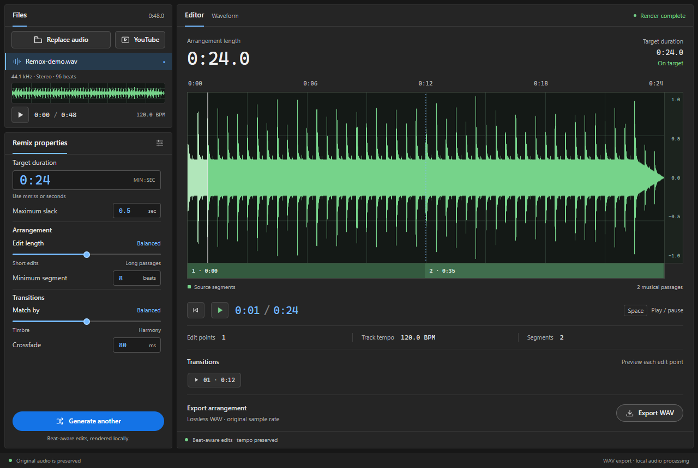

<p align="center">
  
</p>

<h1 align="center">Remox</h1>

<p align="center">
  <strong>Music to your measure.</strong><br />
  Beat-aware duration remixing, on your desktop.
</p>

<p align="center">v0.2.0 · Windows · Rust + Tauri</p>

Remox shortens or extends music to a target duration by rearranging musical
passages. Import a local track or a single YouTube video, preview the edits,
and export a WAV file. Audio analysis and remixing run on your computer.



## Features

- Import local audio or download audio from a single YouTube video.
- Shorten or extend a track while preserving its tempo, opening, and ending.
- Explore source and output waveforms, see the segment map, and audition each edit point.
- Adjust duration tolerance, edit length, minimum segment size, timbre/harmony matching, and crossfades.
- Export lossless 32-bit float WAV at the original sample rate and channel count.
- Keep the original audio unchanged throughout import, remixing, and export.

## Using the app

1. Choose **Import audio** for a local file, or **YouTube** to paste a video link.
2. Set **Target duration** in minutes and seconds (`1:00`) or seconds (`60`). Adjust the remix properties as needed.
3. Select **Generate remix**, play the arrangement, and preview its transitions.
4. Select **Export WAV** to save the arrangement.

Use **Space** to play or pause. Click a waveform to seek, or focus it and use
the arrow keys to move the playback position.

YouTube import requires an internet connection. The app bundles pinned,
checksum-verified download tools; the subsequent audio processing is local.

## Development

Use Node.js 22 and pnpm 12, matching the release workflow. Windows development
also requires Rust, Microsoft C++ Build Tools, WebView2, and PowerShell 7
(`pwsh`). See the [Tauri prerequisites](https://v2.tauri.app/start/prerequisites/)
for the native toolchain setup.

```powershell
pnpm install --frozen-lockfile
pnpm desktop
```

The frontend is in `src/`; the Tauri desktop app and Rust remix engine are in
`src-tauri/`.

### Build for Windows

```powershell
pnpm desktop:build
```

The build produces:

- Executable: `src-tauri/target/release/remox-desktop.exe`
- Installer: `src-tauri/target/release/bundle/nsis/Remox_0.2.0_x64-setup.exe`

You can also run `./build.ps1` to install the locked dependencies and build the
app in one step. Pushing a version tag such as `v0.2.0` triggers the
[Windows release workflow](.github/workflows/release.yml), which builds and
publishes the installer to GitHub Releases.

### Validate changes

```powershell
pnpm check            # TypeScript checks
pnpm test             # Rust engine and media integration tests
pnpm build            # Frontend production build
```

After building the native app, run the desktop checks:

```powershell
pnpm test:desktop     # Native file import, playback, remixing, and WAV export
pnpm test:youtube     # Real YouTube download, playback, remixing, and export
```

Set `REMOX_DESKTOP_EXECUTABLE` to test a particular native executable.

## Engine scope

The engine targets steady-tempo instrumental music. Vocals, tempo changes,
and irregular meter need listening review. Source and target durations are
limited to fifteen minutes; the engine reports an error if it cannot meet the
requested duration tolerance. Exact-duration time stretching is not implemented.

The Rust engine is independently implemented and uses no Adobe code, SDKs, or
models. Its [module documentation](src-tauri/src/engine/mod.rs) describes the
analysis, planning, rendering, and design provenance.

## License

[MIT](LICENSE).
